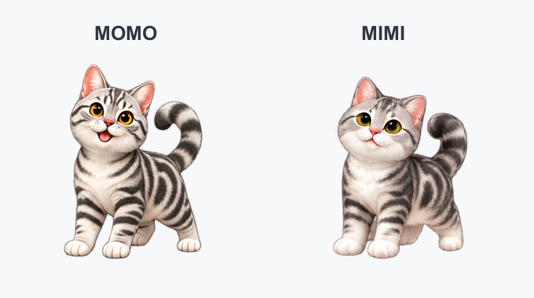

# MOMO, MIMI and Dragon

Personal desktop companions, made just for fun. Each character has a package
for the desktop chat application's Pets feature and a standalone Windows
application. The standalone applications contain their artwork and require
no R, RStudio, .NET installation or internet connection.



## Choose a companion

| Character | Desktop chat pet | Standalone Windows application |
| --- | --- | --- |
| MOMO | [MOMO-GPT](MOMO-GPT/README.md) | [MOMO-Offline](MOMO-Offline/README.md) |
| MIMI | [MIMI-GPT](MIMI-GPT/README.md) | [MIMI-Offline](MIMI-Offline/README.md) |
| Dragon | [Dragon-GPT](Dragon-GPT/README.md) | [Dragon-Offline](Dragon-Offline/README.md) |

The chat pet packages use the transparent v2 sprite-sheet format. The current
MOMO package has no collar. The desktop account also retains the original
collared version under the name **Momo Collar**; the collar-free version is
**Momo**. MIMI retains its original released appearance. Appearance, animation
and switching for these three cat options were confirmed in the desktop app.

Dragon 2.0 uses the approved simplified design, graceful gliding and restrained
human gestures. Its standalone edition uses longer quiet intervals and
once-only responses. See the product folders for details and validation.

## Run a standalone companion

Use Windows 10/11 on Intel or AMD x64. Open the relevant Offline folder and
double-click `MOMO.exe`, `MIMI.exe` or `Dragon-Offline.exe`. The programs are
unsigned. Each EXE contains its artwork and icon and can be moved on its own.

Drag to move, click for a greeting, double-click for a jump or lift, and
right-click for actions, size, preferences and exit. Settings are separate
under `%LOCALAPPDATA%/DesktopPetsLite`.

The [MOMO and MIMI Lite 2.0.0 release](https://github.com/shanlong-who/MOMO/releases/tag/v2.0.0)
retains the published ZIPs. Dragon's current standalone ZIP and self-contained
source ZIP are preserved in [the supporting-file archive](archive/supporting-files-2026-11-13/).

## Project folders

The organized local project contains exactly these eight top-level folders:

```text
Releases/
archive/
Dragon-GPT/
Dragon-Offline/
MOMO-GPT/
MOMO-Offline/
MIMI-GPT/
MIMI-Offline/
```

[Releases](Releases/README.md) contains the published cat packages, shared
native source, artwork and validation. [archive](archive/README.md) contains
original packages, previous editions, Dragon and GPT supporting source, and
verification records. Temporary builds and duplicate extraction checks were
removed during the 2026-11-13 organization. Current EXEs and distribution
ZIPs retain their original checksums.

The repository also retains its README, license, Git configuration files and
Windows release-check workflow. Earlier R editions remain in
[Git history](https://github.com/shanlong-who/MOMO/tree/v1.0.0).

## Source and checks

The standalone applications use C++17, Win32 and Windows GDI+. R is used for
development, artwork preparation, tests and packaging only. Start with the
[MOMO/MIMI source instructions](Releases/2.0.0/Source/README.md) or extract
the [Dragon source ZIP](archive/supporting-files-2026-11-13/Dragon-Source.zip)
to a separate development directory to retain its original sibling layout.

The [published cat validation](Releases/2.0.0/RELEASE-VALIDATION.txt) and
[Dragon validation](archive/supporting-files-2026-11-13/Dragon-RELEASE-VALIDATION.txt)
record the tests performed. The GitHub Windows workflow verifies the existing
MOMO/MIMI release checksums and native rendering tests.

Code and generated artwork use the [MIT License](LICENSE). Packages include
the relevant compiler runtime notices and license texts.
