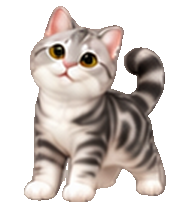

# MOMO & MIMI

A personal cat companion project, made just for fun. Choose the original
chat-app version of MOMO, or an offline desktop cat powered by R.

| MOMO | MIMI |
| :---: | :---: |
|  |  |

## Download a portable desktop cat

For Windows 10/11 on Intel or AMD x64, download either portable ZIP from
[the latest release](https://github.com/shanlong-who/MOMO/releases/latest):

- **MOMO-Portable-1.0.0-windows-x64.zip**
- **MIMI-Portable-1.0.0-windows-x64.zip**

Extract the entire ZIP and double-click **Start MOMO.exe** or **Start MIMI.exe**
(the matching cat icon). The original Start `.cmd` entries remain available.
R 4.6.1, Tcl/Tk and ps are included. No R installation, RStudio, account or
internet connection is needed to run the cats. Download both ZIPs to use both
cats at the same time. Each portable edition has a **Check** launcher for file
integrity and animation diagnostics.

Use the named portable assets on the release page. GitHub's automatic
**Source code (zip)** download contains the source editions, which require an
existing R installation. The original three folders below are retained.

Build instructions, runtime sources and test scope are documented in
[portable/README.md](portable/README.md). SHA-256 checksums, a test report and
the matching R/ps source archives accompany the release.


## Choose a version

| Folder | Version | How to use it |
| --- | --- | --- |
| [MOMO-ChatGPT](MOMO-ChatGPT/README.md) | Original chat-app MOMO assets | Contains the v2 pet package for the chat-app version |
| [MOMO-Offline](MOMO-Offline/README.md) | Offline MOMO for Windows | Open this folder and double-click **Start MOMO.cmd** |
| [MIMI-Offline](MIMI-Offline/README.md) | Offline MIMI for Windows | Open this folder and double-click **Start MIMI.cmd** |

The offline cats can wave, jump, play, stretch, rest, wander around and look at
your cursor. They have the same controls and animation layout, with different
cat artwork. Both can run together and keep their settings separately.

## Repository layout

```text
MOMO/
  MOMO-ChatGPT/
    README.md
    momo-pet-v2.zip
  MOMO-Offline/
    Start MOMO.cmd
    Exit MOMO.cmd
    run_momo.R
    assets/
    scripts/
    tests/
  MIMI-Offline/
    Start MIMI.cmd
    Exit MIMI.cmd
    run_mimi.R
    assets/
    scripts/
    tests/
```

Each offline folder contains its own runtime files and artwork. Keep the
complete folder together when copying or moving it.

## First-time setup for the offline cats

Requirements: Windows 10 or 11, R 4.2 or later with Tcl/Tk, and the **ps** package.
Both cats have been tested with R 4.6.0 and Tcl/Tk 8.6.17 on Windows. This version
uses Windows-specific transparency; macOS and Linux are not supported.

1. Install [R for Windows](https://cran.r-project.org/bin/windows/base/) if needed,
   keeping its Tcl/Tk component enabled.
2. Install the only additional runtime package in that R installation:

   ```r
   install.packages("ps")
   ```

3. Download the repository using **Code → Download ZIP**, or clone it.
4. Extract the whole download. Start the cats from the extracted folders.

Setup may need internet access. Once R, ps and the files are installed locally,
the offline versions work without a network connection. ChatGPT and RStudio
do not need to be open. No packages or artwork are downloaded at startup.

## Start and stop

Open **MOMO-Offline/Start MOMO.cmd** or **MIMI-Offline/Start MIMI.cmd**.
To have both cats on your desktop, open both start files. A console may appear
briefly while R is checked, then close once the cat starts.

Right-click a cat and choose **Exit MOMO** or **Exit MIMI**, or use the matching
exit file in its folder. Opening a start file again brings the same cat home.

The launchers find R using the selected cat's optional `MOMO_RSCRIPT` or
`MIMI_RSCRIPT` setting, then PATH, standard installer registry entries and common
R installation folders. They use the Windows PowerShell included with Windows
to start the installed R in a separate hidden-console process.

To make a desktop shortcut, point it to the selected cat's start file and choose
the matching `assets/momo.ico` or `assets/mimi.ico` as its icon. Recreate the
shortcut if the app folder is moved. Personal Windows shortcuts are not included.

### Start from R or RStudio

From the repository root, choose one command:

```r
source("MOMO-Offline/run_momo.R")
```

```r
source("MIMI-Offline/run_mimi.R")
```

That R session stays busy until the cat closes. Use the Windows launchers or
two separate R sessions to run both cats together.

## Controls

| Action | Result |
| --- | --- |
| Drag a cat | Move it |
| Click | Say hello |
| Double-click | Jump |
| Right-click | Actions, size, pause, settings and exit |
| Open its launcher again | Bring that cat home |

The menu includes wandering, cursor tracking, always-on-top and four sizes.
There is no tray icon. Position bounds use the primary screen, with a taskbar margin.

## Local data and privacy

The offline cats read local artwork. Neither makes network requests, sends
telemetry, uses an account or calls an AI service. They do not add themselves
to Windows startup or change security settings.

Each cat stores preferences in its own R user data directory, and startup logs
and diagnostics in its own R user cache directory. These files stay outside
the repository:

```r
tools::R_user_dir("momo", "data")
tools::R_user_dir("momo", "cache")
tools::R_user_dir("mimi", "data")
tools::R_user_dir("mimi", "cache")
```

For custom setups, `MOMO_DATA_DIR` / `MOMO_CACHE_DIR` and
`MIMI_DATA_DIR` / `MIMI_CACHE_DIR` override these locations. Keep the cats'
data directories separate.

If a cat is not visible, open its launcher again. If R or ps is missing, follow
the startup message and the relevant folder's README. On a managed computer,
follow your organization's IT process if a launcher is blocked.

## Checks

With Rscript on PATH, run these commands from the repository root:

```text
Rscript --vanilla MOMO-Offline/tests/check_public_repository.R
Rscript --vanilla MOMO-Offline/tests/check_companions.R
Rscript --vanilla MOMO-Offline/run_momo.R --self-test
Rscript --vanilla MIMI-Offline/run_mimi.R --self-test
Rscript --vanilla MOMO-Offline/run_momo.R --smoke-test
Rscript --vanilla MIMI-Offline/run_mimi.R --smoke-test
```

The checks cover the public layout and package contents, independent settings
and instance signals, all 74 animation frames at four sizes, cursor directions,
screen bounds and real-window rendering. Reports stay in each cat's cache.

## Artwork and license

Both cats' sprite artwork was created with an AI image-generation tool.
MIMI's appearance was inspired by a supplied cat photograph, using MOMO's atlas
as the motion template. The photograph is not included. MIMI's generation
prompts are in [MIMI-Offline/artwork-prompt.txt](MIMI-Offline/artwork-prompt.txt).

The chat-app ZIP keeps the original manifest and animation sheet. Local build
reports and personal paths have been removed from the public package.
The source code and included generated artwork use the [MIT License](LICENSE).
